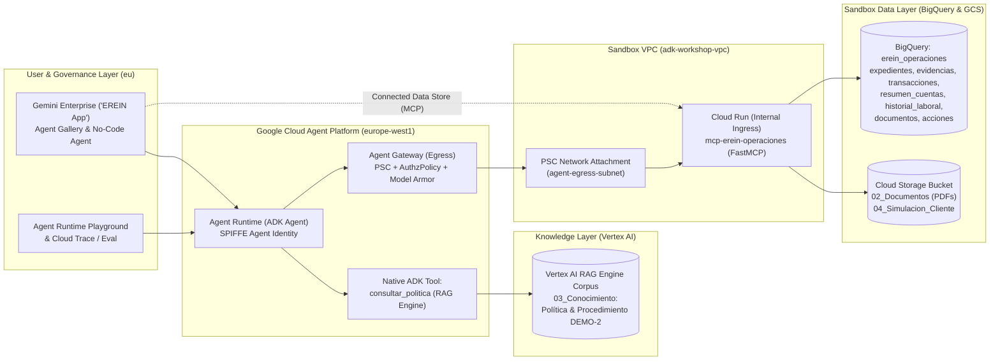

# Agent Platform Workshop for EREIN

October 2026

Author: Miguel Rojo Rossi - miguelrojo@google.com

## Workshop Overview & Architecture

Welcome to the hands-on **Google Cloud Agent Platform Workshop for EREIN**. Over this 4-hour practical session, you will build, secure, deploy, govern, and evaluate an enterprise-grade AI Agent for **Operational Review of Financing Applications (`Revisión Operativa de Operaciones de Activo`)** based on EREIN's synthetic dataset and the **DEMO-2** operational policy.

The agent analyzes customer declarations alongside synthetic evidences in **BigQuery**, payslip and receipt PDFs in **Cloud Storage**, and operational rules in **Vertex AI RAG Engine** (`DEMO-2`). Within its defined authority (`P09`), the agent resolves discrepancies, requests strictly necessary missing documents from the customer, closes expired requests, or escalates complex cases to Operations (`Human-in-the-Loop`)—without ever approving or denying credit.



### 4-Hour Hands-On Agenda

| Time | Task | Focus Area |
| :--- | :--- | :--- |
| **0:00 – 0:30** | **Task 1** | Set up Cloud Workstation, Gemini Enterprise (`EREIN App`), Antigravity CLI (`agy`), and bootstrap BigQuery (`01_Datos`), Cloud Storage (`02_Documentos`), and Vertex AI RAG Engine (`03_Conocimiento`). |
| **0:30 – 1:00** | **Task 2** | Deploy the governed `mcp-erein-operaciones` MCP Server on Cloud Run and test its 5 operational tools. |
| **1:00 – 1:50** | **Task 3** | Build `erein-operational-reviewer` with ADK, Agents CLI, Antigravity, and a **native Vertex AI RAG Engine tool (`consultar_politica`)**, then deploy to **Agent Runtime** with **SPIFFE Agent Identity**. |
| **1:50 – 2:35** | **Task 4** | Lock down the MCP Server (`--ingress=internal`), connect it privately via **Agent Gateway (PSC Egress)**, and configure **Model Armor** guardrails. |
| **2:35 – 3:10** | **Task 5** | Publish the agent to **Gemini Enterprise** and run the interactive case walkthrough (`SYN-001` direct resolution, `SYN-002` document request and session resumption, `SYN-008` PlayStation receipt vs gambling alert, `SYN-006` 15% gambling escalation, `SYN-009` multi-discrepancy). |
| **3:10 – 3:35** | **Task 6** | Expose the MCP Server (`--ingress=all`), connect it as a **Gemini Enterprise Data Store**, and create a **No-Code Agent**. |
| **3:35 – 4:00** | **Task 7** | Analyze end-to-end **Observability & Traces**, execute the automated **10-Scenario Evaluation** against `05_Evaluacion/evaluacion_formador.csv`, and review production architecture patterns. |

## Task 1.- Set up your environment and Sandbox Data

1. You will run the workshop from a Cloud Workstation running Visual Studio Code. Open the following link using an **Incognito Window** and enter the sandbox credentials that you have been given at the beginning of the workshop. **You may have to select your project at the top of the screen**.

[https://console.cloud.google.com/workstations/list](https://console.cloud.google.com/workstations/list)

2. Once you are in the Cloud Workstation console you will see a workstation already created for you with the name `adk-workshop-ws`. The workstation is a virtual development environment that runs in the cloud which starts on demand and is stopped when you are not using it. It should be stopped. **Click on the Launch** button next to it to start it and wait for it to start (this will take a couple of minutes).

3. Close the "Gemini Code Assist" tab if it is open in the workstation and **open a New Terminal**. You can do this from the left menu by clicking on **Terminal -> New Terminal**.

4. Once the terminal is open, enter the following command to create a folder for the labs:

```bash
mkdir labs
```

5. Now click on "**Open Folder**", select the **labs** folder and click on **OK**.

6. Close again the welcome tabs that have opened and open a new terminal in the same way as you did in Step 3.

7. Install `uv`, a fast Python package and environment manager:

```bash
curl -LsSf https://astral.sh/uv/install.sh | sh
source $HOME/.local/bin/env
```

8. Run the Agents CLI setup command using `uvx` (included with `uv`). This installs the ADK and Agent Platform skills into your environment:

```bash
uvx google-agents-cli setup
```

9. Create a Gemini Enterprise App and Configure Its Identity Provider. Before logging into `antigravity-cli`, you must create a Gemini Enterprise instance and configure its identity provider so your user account is granted the Gemini Enterprise Plus entitlement:
    1. In the Google Cloud Console, navigate to the **Gemini Enterprise** page by searching for it at the top of the console.
    2. Click on **Create your first app**.
    3. You will be presented with an app creation screen. Name your app "**EREIN App**".
    4. Choose **eu** as location.
    5. Under Advanced Options, for a company name, enter "**EREIN**".
    6. Click **Create**. Once it finishes you will be presented with the Gemini Enterprise Admin console for your app.
    7. Go to the [Gemini Enterprise page](https://console.cloud.google.com/gemini-enterprise/apps).
    8. Under **Settings**, go to the **Authentication** tab, and for the **eu** location select **Google Identity** as your identity provider.
    9. Click on **Save**.
    10. On the **AI developer tools** tab click on "**Enable Required APIs**".
    11. Click on **Enable** and wait for it to complete.
    12. Now enable the slider for **AI developer tools**.

10. Once your Gemini Enterprise app and identity provider are configured, return to your Cloud Workstation terminal and authenticate Antigravity CLI (`antigravity-cli`) with Gemini Enterprise Plus:
   1. Run Antigravity CLI:

```bash
agy
```

   2. Select "**Use a Google Cloud project**" as the login method.
   3. Select "**Continue with Google Cloud**".
   4. Open the authorization URL in your browser, sign in with your workshop credentials, copy the authorization code and paste the authorization code back into the terminal.
   5. If no licenses are found enter your **Google Cloud Project ID** and press Enter. You may find your Project ID in the [Welcome Screen of your Google Cloud Project](https://console.cloud.google.com/welcome).
   6. Select **eu** as your Google Cloud Location.
   7. Verify that your license tier displays **Gemini Enterprise Plus** and press **Enter**.
   8. Choose your color scheme and press **Next**. Accept the terms of service and click on **Done**.
   9. Confirm that you trust the `/home/user/labs` folder.
   10. Antigravity CLI is now ready. Press `CTRL + C` twice to exit the interactive `antigravity-cli` shell and return to bash.

11. Clone the workshop repository containing EREIN's synthetic dataset (`EREIN_CdU_Revision_Operativa_Agentica`), the FastMCP server (`mcp_erein_operaciones`), and the bootstrap scripts:

```bash
cd ~/labs
git clone https://github.com/miguelrojorossi/erein_agents_workshop.git
cd erein_agents_workshop
```

12. Run the automated sandbox bootstrap script. This single command loads the CSV tables from `01_Datos` into BigQuery (`erein_operaciones`), uploads the payslip and receipt PDFs from `02_Documentos` into Cloud Storage (`gs://$PROJECT_ID-erein-docs`), and creates the **Vertex AI RAG Engine** corpus (`erein-demo2-rag-corpus`) indexing only the two policy and procedure PDFs in `03_Conocimiento` (`Politica_Revision_Operativa_DEMO2.pdf` and `Procedimiento_Revision_Operativa_DEMO2.pdf`):

```bash
export PROJECT_ID="YOUR_PROJECT_ID"
gcloud auth login
gcloud config set project $PROJECT_ID
./scripts/bootstrap_erein_env.sh
source .env.workshop
```

> **Important:** The bootstrap script intentionally keeps `04_Simulacion_Cliente` (the customer's delayed September payslip for `SYN-002`) and `05_Evaluacion` (the trainer's expected results) **outside** the initial BigQuery tables, Cloud Storage bucket, and RAG corpus so the agent cannot access future responses or evaluation ground truth prematurely.

## Task 2.- Deploying the Operational Review MCP Server

During this workshop we will use an MCP Server (`mcp_erein_operaciones`) which provides **five governed operational tools** over BigQuery and Cloud Storage, enforcing strict isolation by `caso_id`, parameterized SQL (no arbitrary free SQL from the LLM), and idempotency via `accion_id`:

- `consultar_expediente`: Retrieves the declared application fields, initial evidences (masking raw payslip amounts to force the agent to verify the PDF documents), available document references, and prior recorded actions for `caso_id`.
- `leer_documento`: Verifies that `documento_id` belongs to `caso_id`, reads the PDF from Cloud Storage (`02_Documentos`), and returns the document ID, page number (`1`), availability status, and extracted text.
- `consultar_transacciones`: Executes parameterized queries on `transacciones` (July–September 2026) and `resumen_cuentas` (monthly balances, overdrafts, returns, and defaults), plus analytical ratios (such as monthly gambling spend vs. net salary for `P13`).
- `consultar_historial_laboral`: Retrieves employment history across companies and business groups (`SYN-004`).
- `registrar_accion_expediente`: Validates operational authority boundaries (`P09` — blocking any attempt to grant/deny loans or label a case `"No elegible"`), prevents duplicate writes via `accion_id`, and persists the decision into the BigQuery `acciones` table.

Now let's proceed to **deploy the MCP Server on Cloud Run**, initially deployed publicly so we can inspect and test it.

1. Deploy the MCP server on Cloud Run from the `mcp_erein_operaciones` directory. Accept the Artifact Registry repository creation if prompted. Write down the service URL once it finishes (around 3–5 minutes):

```bash
cd ~/labs/erein_agents_workshop/mcp_erein_operaciones
gcloud run deploy mcp-erein-operaciones \
  --allow-unauthenticated \
  --region=europe-west1 \
  --ingress=all \
  --set-env-vars="PROJECT_ID=${PROJECT_ID},BQ_DATASET=erein_operaciones,GCS_BUCKET=${PROJECT_ID}-erein-docs" \
  --source .
```

Once the process has finished it will output the URL (`*.run.app`) where the MCP Server is hosted.

2. Assign the Cloud Run URL to the variable `MCP_URL` with a trailing `/mcp`, and run a JSON-RPC `initialize` handshake against your Cloud Run endpoint from the Cloud Workstation:

```bash
export MCP_URL="https://YOUR_SERVICE_URL.run.app/mcp"
curl -i -X POST "${MCP_URL}" \
  -H "Content-Type: application/json" \
  -H "Accept: application/json, text/event-stream" \
  -d '{
    "jsonrpc": "2.0",
    "id": 1,
    "method": "initialize",
    "params": {
      "protocolVersion": "2024-11-05",
      "capabilities": {},
      "clientInfo": {"name": "erein-curl-test", "version": "1.0.0"}
    }
  }'
```

If everything is correct the output will be an `HTTP/2 200` response confirming the `EreinOperacionesMCP` server capabilities.

3. You can also run the automated local verification script to see all 5 MCP tools and security guardrails in action:

```bash
cd ~/labs/erein_agents_workshop
python3 scripts/test_mcp_tools.py
```

## Task 3.- Build an Agent with ADK, Vertex AI RAG Engine, Agents CLI and Antigravity, and Deploy it to Agent Runtime

In this task we will **build and deploy EREIN's Operational Review AI Agent using the Agent Development Kit (ADK) with the Agents CLI in Agent Platform and Antigravity CLI**.

Crucially, our agent will combine **two complementary tool mechanisms**:
1. **A Native ADK Tool (`consultar_politica`) powered by Vertex AI RAG Engine**: Queries the `erein-demo2-rag-corpus` (`$RAG_CORPUS_NAME`) containing `Politica_Revision_Operativa_DEMO2.pdf` and `Procedimiento_Revision_Operativa_DEMO2.pdf` to retrieve rules `P01` through `P13`.
2. **Remote MCP Tools (`MCPToolset`)**: Connects to your `mcp-erein-operaciones` Cloud Run server (`$MCP_URL`) to query BigQuery, read customer PDFs from Cloud Storage, and persist actions.

1. Make sure your environment variables from Task 1 and Task 2 are exported (`PROJECT_ID`, `RAG_CORPUS_NAME`, and `MCP_URL`), then launch Antigravity CLI:

```bash
cd ~/labs/erein_agents_workshop
source .env.workshop
echo "RAG_CORPUS_NAME=${RAG_CORPUS_NAME}"
echo "MCP_URL=${MCP_URL}"
agy
```

2. First check the Skills available by entering `/skills`. Agents CLI has installed specialized skills (`google-agents-cli-workflow`, `google-agents-cli-scaffold`, `google-agents-cli-adk-code`, `google-agents-cli-evaluate`, `google-agents-cli-deploy`) so that Antigravity knows how to scaffold, code, evaluate, and deploy ADK agents on Google Cloud.

3. Press `Esc` and instruct Antigravity to create the agent with the following prompt:

```markdown
Use agents-cli to create an agent named "erein-operational-reviewer" with the following specifications:
1. Role & Identity:
   - Expert AI Operational Analyst (Analista de Revisión Operativa de Operaciones de Activo) representing EREIN.
   - Language: Spanish by default, switching to English if addressed in English.
   - Fixed Simulated Evaluation Date: 2026-10-14 (14 de octubre de 2026). All deadlines and reminders must be evaluated relative to 2026-10-14.
   - Authority Boundaries (Rule P09): The operational review precedes Risk underwriting. NEVER approve, grant, or reject a loan, and NEVER label a case as "No elegible". Only use the five allowed states from Procedure DEMO-2:
     * "En revisión"
     * "Pendiente de evidencia"
     * "Escalado a Operaciones"
     * "Resuelto"
     * "Cerrado por evidencia incompleta"
2. Goal:
   - Analyze financing applications (cases SYN-001 through SYN-010) by contrasting declared customer data against available evidences in BigQuery, PDF payslips/receipts/contracts in Cloud Storage, and bank transactions (July–September 2026).
   - Resolve discrepancies within your operational authority, request strictly necessary missing documents from the customer, close cases with expired evidence deadlines (10 days after request with reminders at days 3 and 7), or escalate complex/sensitive cases to Operations with a structured analysis.
3. Tool Integration (Native Vertex AI RAG Engine Tool + Remote MCP Server):
   - Native ADK Tool (`consultar_politica`): Implement a native Python tool inside the ADK agent using `vertexai.preview.rag.retrieval_query` against the Vertex AI RAG Engine corpus "$RAG_CORPUS_NAME" in region "europe-west1" (which indexes 03_Conocimiento/Politica_Revision_Operativa_DEMO2.pdf and Procedimiento_Revision_Operativa_DEMO2.pdf) to retrieve applicable DEMO-2 rules (P01–P13).
   - MCP Server ("$MCP_URL"): Connect using ADK `MCPToolset` (`StreamableHTTPConnectionParams`) to call:
     * `consultar_expediente(caso_id)`: Retrieves declared fields, initial evidences (payslip amounts are masked to enforce reading the PDF), document IDs, and prior recorded actions.
     * `leer_documento(caso_id, documento_id)`: Reads the authorized PDF for `caso_id` and returns the document ID, page number, and extracted text.
     * `consultar_transacciones(caso_id, desde, hasta)`: Retrieves July–September 2026 bank transactions, monthly account summaries (balances, overdrafts, returns, defaults), and analytical breakdowns.
     * `consultar_historial_laboral(caso_id)`: Retrieves employment history across companies and business groups.
     * `registrar_accion_expediente(...)`: Records the final operational decision in the BigQuery `acciones` table with an idempotent `accion_id` (e.g., ACC-SYN-001-01), policy version "DEMO-2", cited `evidencias_ids`, and `reglas_ids`.
4. Key Operational Rules (DEMO-2):
   - P01 & P02: Two matching recent payslips and bank credits prove recurring income. Exclude extraordinary bonuses (SYN-001 -> update income to 2100 EUR) and transfers between own accounts (SYN-009 -> update income to 2200 EUR).
   - P03: If a salary increase (SYN-002 after receiving September payslip of 2500 EUR vs 2100 EUR in August) does not yet have two matching months under P01, escalate to Operations ("Escalado a Operaciones").
   - P05: Active financial contract + matching monthly debits prove an undeclared monthly installment (SYN-005: 180 EUR; SYN-009: 150 EUR).
   - P06: Legible original PDF prevails over erroneous automatic extraction (SYN-003: 2200 EUR in PDF vs 22000 EUR extracted).
   - P07, P10 & P13: For GAMBLING alerts, first verify if the provider category is accurate. If a purchase receipt matches holder, date, amount, and payment reference (SYN-008: PlayStation 5 console for 499 EUR at GAME DEMO ELECTRONICA, ref TX-SYN-008-09-GAME in DOC-SYN-008-E06), discard the alert as a commercial purchase and resolve ("Resuelto", income 2300 EUR). If real recurring gambling is confirmed (SYN-006: 450 EUR/month = 15% of 3000 EUR net salary each month and 1350/9000 = 15% in the quarter, with 0 overdrafts/incidents), record the context and escalate to Operations ("Escalado a Operaciones") without automatic rejection.
   - P08: Request only missing required evidence (SYN-002 Phase 1 -> "Pendiente de evidencia"). If 10 days have elapsed since the initial request after day 3 and day 7 reminders without a legible response (SYN-010: requested 2026-10-03, reminders 2026-10-06 and 2026-10-10, evaluated 2026-10-14), close as "Cerrado por evidencia incompleta".
   - P11: Undeclared rental income supported by lease contract and 3 monthly transfers (SYN-007: 700 EUR/month) must be recorded separately in `renta_bruta_observada_eur_mes = 700` (never added to net salary 2000 EUR) and escalated to Operations ("Escalado a Operaciones").
   - P12: Intra-group employer change (SYN-004: Grupo Norte Demo) backed by continuous employment history (`DOC-SYN-004-E05`) and company continuity certificate (`DOC-SYN-004-E06`) preserves recognized seniority from `2021-10-01` ("Resuelto", income 2300 EUR).
5. Output Delivery:
   - Always cite `evidencia_id`, `documento_id` + page number, and `reglas_ids` (version `DEMO-2`), and confirm the `accion_id` persisted in BigQuery.
```

> **Tip:** You can also inspect or copy the ready-made reference implementation in `erein_agent_reference/app/agent.py` and `erein_agent_reference/app/rag_tool.py` at any time.

4. Once Antigravity finishes creating the agent, exit Antigravity with `CTRL + C` twice and test the agent locally from the terminal against scenario **`SYN-001`** (Declared income of 2,500 € vs. 2,100 € payslip + 400 € bonus):

```bash
cd ~/labs/erein_agents_workshop/erein-operational-reviewer
agents-cli run "Realiza la revisión operativa del expediente SYN-001. Consulta el expediente, la política DEMO-2 en RAG, lee las nóminas en PDF, revisa las transacciones y registra la resolución correspondiente."
```

You will see the agent:
- Call `consultar_expediente("SYN-001")` and observe that the payslip amounts are masked.
- Call the native ADK RAG Engine tool `consultar_politica` to retrieve rules `P01`, `P02`, and `P09`.
- Call `leer_documento` on `DOC-SYN-001-E02` (August, p. 1: 2,100 €) and `DOC-SYN-001-E04` (September, p. 1: 2,100 €).
- Call `consultar_transacciones("SYN-001")` to confirm the 400 € payment is an extraordinary bonus (`BONUS`).
- Call `registrar_accion_expediente` setting state to **`Resuelto`**, updating `ingreso_actualizado_eur_mes = 2100`, and citing `P01 P02 P09` (`version_politica = "DEMO-2"`).

5. Now deploy the agent to **Agent Runtime** with **SPIFFE Agent Identity**:

```bash
agents-cli scaffold enhance --deployment-target agent_runtime
agents-cli deploy --project $PROJECT_ID --region europe-west1 --agent-identity
```

The deployment takes a few minutes to complete. After it finishes, the CLI outputs a confirmation message and a link to your agent's playground in the Google Cloud Console.

6. Check your agent's **SPIFFE ID (Agent Identity)** and grant it access to your Vertex AI RAG Engine corpus:
    1. In the Google Cloud Console, go to the [Agent Runtime Deployments](https://console.cloud.google.com/agent-platform/runtimes) page.
    2. Find the row for `erein-operational-reviewer`, and in the **Identity** column click **Copy to clipboard**. The identity looks similar to:
       `principal://agents.global.org-ORGANIZATION_ID.system.id.goog/resources/aiplatform/projects/PROJECT_NUMBER/locations/europe-west1/reasoningEngines/ENGINE_ID`
    3. Grant your agent's SPIFFE principal the `roles/aiplatform.user` role so it can query Vertex AI RAG Engine directly under its own cryptographic identity:

```bash
export AGENT_SPIFFE_ID="PASTE_YOUR_AGENT_SPIFFE_ID_HERE"
gcloud projects add-iam-policy-binding $PROJECT_ID \
  --member="${AGENT_SPIFFE_ID}" \
  --role="roles/aiplatform.user"
```

7. Browse to [Agent Runtime](https://console.cloud.google.com/agent-platform/runtimes) in the Google Cloud Console, click on the **`erein-operational-reviewer`** agent, and test it in the **Playground** using scenario **`SYN-008`** (False positive gambling alert for a PlayStation 5 purchase):

```markdown
Analiza y resuelve el expediente SYN-008. Verifica la alerta de categoría bancaria GAMBLING contrastando los movimientos, la política DEMO-2 y el justificante documental disponible, y registra la acción.
```

You will see the agent invoke the Vertex AI RAG Engine tool (`consultar_politica`), inspect `DOC-SYN-008-E06` (page 1: PlayStation 5 console at `GAME DEMO ELECTRONICA` for `499.00 EUR`, ref `TX-SYN-008-09-GAME`), discard the false-positive gambling alert under rule **`P10`** without overwriting the original transaction category, and record **`Resuelto`** (`ingreso_actualizado_eur_mes = 2300`).

## Task 4.- Connecting to a Private MCP Server using Agent Gateway and Model Armor

In a regulated financial institution like EREIN, operational microservices and BigQuery/GCS data access layers must never be exposed to the public internet. In this task we will:
1. Lock down the Cloud Run MCP Server to **internal VPC ingress only** (`--ingress=internal`).
2. Provision an **Agent Gateway** (`AGENT_TO_ANYWHERE` egress mode) using a **Private Service Connect (PSC) Network Attachment** to bridge Agent Runtime privately into your VPC.
3. Configure **Model Armor** security guardrails to protect the agent against prompt injection, jailbreaks, and sensitive data leakage.

1. Redeploy the MCP server on Cloud Run changing `--ingress` to `internal`:

```bash
cd ~/labs/erein_agents_workshop/mcp_erein_operaciones
gcloud beta run deploy mcp-erein-operaciones \
  --allow-unauthenticated \
  --region=europe-west1 \
  --ingress=internal \
  --set-env-vars="PROJECT_ID=${PROJECT_ID},BQ_DATASET=erein_operaciones,GCS_BUCKET=${PROJECT_ID}-erein-docs" \
  --source .
```

2. Open the Cloud Run URL in your local browser. **You will receive a 404 / Forbidden error** because the MCP Server is no longer exposed to the public internet. However, running the `curl` handshake from your Cloud Workstation terminal still succeeds because your workstation sits inside `adk-workshop-vpc`.

3. If you test the agent right now from the [Agent Runtime](https://console.cloud.google.com/agent-platform/runtimes) Playground, the MCP tool calls will fail because Agent Runtime runs in a Google-managed tenant network without direct access to your private VPC.

4. Let's create the subnet and PSC Network Attachment that Agent Gateway will use to ingress into your VPC:

```bash
gcloud compute networks subnets create agent-egress-subnet \
  --network=adk-workshop-vpc \
  --range=10.2.0.0/24 \
  --region=europe-west1 \
  --enable-private-ip-google-access
```

5. Grant the Vertex AI / Agent Platform Service Agent the `compute.networkAdmin` and `dns.peer` roles:

```bash
export PROJECT_NUMBER=$(gcloud projects describe $PROJECT_ID --format="value(projectNumber)")
gcloud projects add-iam-policy-binding $PROJECT_ID \
  --member="serviceAccount:service-${PROJECT_NUMBER}@gcp-sa-aiplatform.iam.gserviceaccount.com" \
  --role="roles/compute.networkAdmin"
gcloud projects add-iam-policy-binding $PROJECT_ID \
  --member="serviceAccount:service-${PROJECT_NUMBER}@gcp-sa-aiplatform.iam.gserviceaccount.com" \
  --role="roles/dns.peer"
```

6. Create the PSC Network Attachment referencing `agent-egress-subnet`:

```bash
gcloud compute network-attachments create mcp-network-attachment \
  --region=europe-west1 \
  --connection-preference=ACCEPT_AUTOMATIC \
  --subnets=agent-egress-subnet

export NETWORK_ATTACHMENT="projects/$PROJECT_ID/regions/europe-west1/networkAttachments/mcp-network-attachment"
```

7. Create a **Model Armor** template in `europe-west1` to enforce prompt injection, jailbreak, and sensitive data guardrails on agent traffic:

```bash
gcloud model-armor templates create erein-operaciones-armor \
  --location=europe-west1 \
  --project=$PROJECT_ID \
  --rai-settings-filters='[{"filterType":"HATE_SPEECH","confidenceLevel":"MEDIUM_AND_ABOVE"},{"filterType":"DANGEROUS","confidenceLevel":"MEDIUM_AND_ABOVE"}]' \
  --pi-and-jailbreak-filter-settings-enforcement=ENABLED \
  --pi-and-jailbreak-filter-settings-confidence-level=LOW_AND_ABOVE
```

8. Set up the **Agent Gateway** in egress mode `AGENT_TO_ANYWHERE` through the Google Cloud Console:
    1. Go to the [Agent Gateways page](https://console.cloud.google.com/agent-platform/gateways).
    2. Click **Add Gateway**.
    3. In the **Name** field, enter **`erein-agent-gateway-egress`**.
    4. In **Region**, select **`europe-west1`**.
    5. In **Deployment mode**, select **Google-managed**.
    6. In **Agent registries**, select **Regional registry**.
    7. Under **Governed Access Path**, select **Agent-to-Anywhere (egress)**.
    8. Under **Access Authorization**, select **Audit-only**.
    9. In **Policy Model**, select **Unified Access Policy**.
    10. Enable **Model Armor** and select the **`erein-operaciones-armor`** template created in Step 7 (or keep it in Audit/Inspect mode if preferred).
    11. Click **Add Gateway** (creation takes ~5 minutes).

9. After the Gateway creation completes, attach your PSC Network Attachment:
    1. Click on **`erein-agent-gateway-egress`**.
    2. At the bottom in the **Network attachment** field, select **`mcp-network-attachment`**.
    3. Click **Save**.

10. Store the Gateway resource name in `GATEWAY_NAME` and grant the Agent Gateway Service Agent the required network and DNS roles:

```bash
export GATEWAY_NAME=$(gcloud network-services agent-gateways describe erein-agent-gateway-egress --location=europe-west1 --format="yaml(name)" | awk '{print $2}')

gcloud projects add-iam-policy-binding $PROJECT_ID \
  --member="serviceAccount:service-${PROJECT_NUMBER}@gcp-sa-agentgateway.iam.gserviceaccount.com" \
  --role="roles/compute.networkAdmin"
gcloud projects add-iam-policy-binding $PROJECT_ID \
  --member="serviceAccount:service-${PROJECT_NUMBER}@gcp-sa-agentgateway.iam.gserviceaccount.com" \
  --role="roles/dns.peer"
```

11. Create an authorization policy on the gateway and configure DNS peering for `run.app.`:

```bash
curl -X POST \
  "https://networksecurity.googleapis.com/v1alpha1/projects/${PROJECT_ID}/locations/europe-west1/authzPolicies?authzPolicyId=erein-agent-gateway-egress-authz-allow-all" \
  -H "Authorization: Bearer $(gcloud auth print-access-token)" \
  -H "X-Goog-User-Project: ${PROJECT_NUMBER}" \
  -H "Content-Type: application/json" \
  -d '{
    "target": {
      "resources": [
        "'"${GATEWAY_NAME}"'"
      ]
    },
    "httpRules": [
      {
        "to": {
          "operations": [
            {
              "paths": [
                {
                  "prefix": "/"
                }
              ]
            }
          ]
        }
      }
    ],
    "action": "ALLOW",
    "policyProfile": "REQUEST_AUTHZ"
  }'

curl -X PATCH \
  "https://networkservices.googleapis.com/v1alpha1/projects/${PROJECT_ID}/locations/europe-west1/agentGateways/erein-agent-gateway-egress?updateMask=networkConfig.dnsPeeringConfig" \
  -H "Authorization: Bearer $(gcloud auth print-access-token)" \
  -H "X-Goog-User-Project: ${PROJECT_NUMBER}" \
  -H "Content-Type: application/json" \
  -d @- <<EOF
{
  "networkConfig": {
    "dnsPeeringConfig": {
      "domains": [
        "run.app."
      ],
      "targetProject": "${PROJECT_ID}",
      "targetNetwork": "projects/${PROJECT_ID}/global/networks/adk-workshop-vpc"
    }
  }
}
EOF
```

12. Confirm that the Gateway configuration and PSC connection endpoint are active:

```bash
gcloud network-services agent-gateways describe erein-agent-gateway-egress \
  --location=europe-west1 \
  --format="yaml(registries,networkConfig,name)"

gcloud compute network-attachments describe mcp-network-attachment \
  --region=europe-west1 \
  --format="yaml(connectionEndpoints)"
```

13. Update your ADK agent configuration in `agents-cli` to route egress traffic through the Agent Gateway and redeploy:

```bash
cd ~/labs/erein_agents_workshop/erein-operational-reviewer
agents-cli scaffold enhance . --agent-gateway
agents-cli deploy --project $PROJECT_ID --region europe-west1 --agent-identity --agent-gateway-egress $GATEWAY_NAME
```

14. Test the agent again from the [Agent Runtime](https://console.cloud.google.com/agent-platform/runtimes) Playground—it can now securely invoke the private Cloud Run MCP Server through Agent Gateway!

## Task 5.- Publishing your Agent to Gemini Enterprise & Running the Operational Review Sequence

In this task we will publish the Agent running in Agent Runtime into **Gemini Enterprise** so EREIN's Operations analysts can interact with it under corporate governance, and we will test the key operational scenarios requested by EREIN.

### Part A: Publish the Agent in Gemini Enterprise

1. Go to the [Agent Runtime Deployments page](https://console.cloud.google.com/agent-platform/runtimes) in the Google Cloud Console and click the copy button next to the **Resource name** of `erein-operational-reviewer`.

2. Configure Gemini Enterprise features:
   1. Go to the [Gemini Enterprise page](https://console.cloud.google.com/gemini-enterprise/apps) and click on your **EREIN App**.
   2. On the left menu click on **Configurations**.
   3. Click on the **Feature Management** tab.
   4. Enable **Chat**, **model selector**, **canvas**, **Enable End Users to share with Groups**, **skills**, **Enable skill sharing**, and **projects**.
   5. Disable "**Enable agent sharing without admin approval**".
   6. Click **Save**.

3. Register the Agent Runtime agent in Gemini Enterprise:
   1. On the left menu click on **Agents** -> **Add agent**.
   2. In the section "**Custom agent via Agent Runtime**" click **Add**.
   3. On Authorizations click **Next**.
   4. Enter "**Agente Revisor Operativo EREIN**" as the **Agent name**.
   5. In the **Describe your agent** box enter: "**Agente de revisión operativa de solicitudes de financiación (Política DEMO-2)**".
   6. In the **Agent Runtime reasoning engine** field, paste the Resource ID you copied in Step 1.
   7. Click **Create**.

4. Share the agent with users in your organization:
   1. Click on **Agente Revisor Operativo EREIN** -> **User permissions** -> **Add user**.
   2. Select "**All users**" and assign the role "**Agent User**", then click **Save**.
   3. On the left menu click **Overview** and open the link to your **Gemini Enterprise Web App** (`https://vertexaisearch.cloud.google.com/...`).
   4. Navigate to **Agents** -> **From your organization**, and click on **Agente Revisor Operativo EREIN**.

### Part B: Guided Operational Case Walkthrough

Now run the following four operational scenarios in Gemini Enterprise to validate **direct resolution**, **document request with session resumption**, **Human-in-the-Loop escalation**, and **multi-discrepancy resolution**:

#### Scenario 1: Direct Resolution (`SYN-001` — Bonus Exclusion)

```markdown
Realiza la revisión operativa del expediente SYN-001. Analiza los datos declarados frente a las nóminas en PDF y los movimientos bancarios aplicando la política DEMO-2, y registra la resolución.
```

- **Expected Behavior**: Reads `DOC-SYN-001-E02` and `DOC-SYN-001-E04` (page 1: 2,100 € net salary), identifies the 400 € transfer in September as a non-recurring bonus (`SYN-001-E05`, `SYN-001-E06`), cites rules **`P01 P02 P09`**, updates `ingreso_actualizado_eur_mes = 2100`, and records state **`Resuelto`**.

#### Scenario 2: Missing Document Request & Case Resumption (`SYN-002` — Two-Phase Flow)

**Phase 1 (Initial Review — Missing September Payslip)**:

```markdown
Revisa el expediente SYN-002. Comprueba las evidencias y documentos disponibles y ejecuta la acción que corresponda según la política DEMO-2.
```

- **Expected Behavior**: Detects that the customer declared a salary increase in September (2,500 € bank credit `SYN-002-E03` vs. 2,100 € August payslip `DOC-SYN-002-E02`), sees that the September payslip (`DOC-SYN-002-E04`) is **`Ausente`**, cites **`P01 P03 P08 P09`**, records state **`Pendiente de evidencia`**, and generates a targeted message asking the customer exclusively for the September 2026 payslip.

**Simulate Customer Document Submission (Run in Cloud Workstation Terminal)**:

In your Cloud Workstation terminal, run the simulation script to upload `04_Simulacion_Cliente/SYN-002_septiembre.pdf` to Cloud Storage and register `SYN-002-E05` / `DOC-SYN-002-E05` in BigQuery:

```bash
cd ~/labs/erein_agents_workshop
python3 scripts/simulate_customer_response.py --case SYN-002
```

**Phase 2 (Resume Case `SYN-002` & Escalate per Rule `P03`)**:

Return to the agent chat and send:

```markdown
El cliente ha aportado la nómina de septiembre pendiente para el expediente SYN-002. Reanuda la revisión operativa del expediente SYN-002 con la nueva evidencia disponible y registra la decisión final.
```

- **Expected Behavior**: Calls `consultar_expediente("SYN-002")` (seeing the prior `Pendiente de evidencia` action and the newly available `DOC-SYN-002-E05`), reads `DOC-SYN-002-E05` (page 1: 2,500 € net salary), checks `consultar_politica` for rule **`P03`** (*if a new salary does not yet satisfy the two matching recent payslips of `P01`, escalate the calculation to Operations*), and records a new action (`ACC-SYN-002-02`) with state **`Escalado a Operaciones`** citing **`P01 P03 P09`**.

#### Scenario 3: Human-in-the-Loop Escalation on Sensitive Alert (`SYN-006` — 15% Gambling Spend)

```markdown
Analiza el expediente SYN-006 que presenta una alerta por movimientos recurrentes categorizados como apuestas. Calcula las métricas requeridas por la política DEMO-2 y registra la actuación.
```

- **Expected Behavior**: Verifies 3,000 € net salary in `DOC-SYN-006-E02` and `DOC-SYN-006-E04`, inspects transactions to calculate **`450 / 3000 = 15%` each month** and **`1350 / 9000 = 15%` across the quarter**, explicitly notes **0 overdrafts, returns, or defaults** in the July–September period, and escalates to Operations (**`Escalado a Operaciones`**) under rules **`P01 P07 P09 P13`** without automatic rejection.

#### Scenario 4: Multi-Discrepancy Resolution (`SYN-009` — Own Transfers + Undeclared Loan)

```markdown
Realiza la revisión operativa completa del expediente SYN-009, que presenta diferencias tanto en ingresos como en obligaciones financieras, y registra la resolución.
```

- **Expected Behavior**: Simultaneously resolves both discrepancies: excludes the 400 €/month transfers from the customer's own external account (verified by ownership certificate `SYN-009-E09`, setting `ingreso_actualizado_eur_mes = 2200` per `P01 P02`) and registers the undeclared 150 €/month financial installment (verified by contract `SYN-009-E10` and monthly debits `SYN-009-E06`, `SYN-009-E08`, setting `cuota_actualizada_eur_mes = 150` per `P05`), recording state **`Resuelto`** under **`P01 P02 P05 P09`**.

## Task 6.- Creating an MCP Server Datastore in Gemini Enterprise and Building a No-Code Agent

In this task we will publish our MCP Server (`mcp-erein-operaciones`) as a tool connector in Gemini Enterprise and build a **No-Code Agent** directly in the Gemini Enterprise Agent Builder.

1. First, update the ingress of the `mcp-erein-operaciones` Cloud Run service from `internal` back to `all` so that Gemini Enterprise can reach the MCP Server endpoint when registering and invoking actions:

```bash
cd ~/labs/erein_agents_workshop/mcp_erein_operaciones
gcloud run services update mcp-erein-operaciones \
  --region=europe-west1 \
  --ingress=all
```

2. Register the MCP Server as a Connected Data Store:
   1. Go to the [Gemini Enterprise Applications console](https://console.cloud.google.com/gemini-enterprise/apps) and click on your **EREIN App**.
   2. On the left panel click on **Connected data stores** -> **New data store**.
   3. Under **Custom MCP Server**, click on **Add MCP Server**.
   4. Select **No authentication** and enter your `MCP_URL` (`https://YOUR_SERVICE_URL.run.app/mcp`).
   5. Click **Continue**, enter "**MCP Operaciones EREIN**" as your Data connector name, and click **Create**.
   6. Click on **Actions** -> **Reload custom actions**, select the 5 operational tools (`consultar_expediente`, `leer_documento`, `consultar_transacciones`, `consultar_historial_laboral`, `registrar_accion_expediente`), and click **Enable actions**.

3. Create the No-Code Chat Agent in Gemini Enterprise:
   1. Open your Gemini Enterprise Web App (`https://vertexaisearch.cloud.google.com/...`), click on **Agents** -> **New agent** -> **Chat Agent** -> **Build manually**.
   2. Click on **My Agent**, name it "**Agente Revisor Operativo No-Code**", and set the description to "**Agente No-Code para revisión operativa de expedientes de financiación (DEMO-2)**".
   3. Paste the system instructions from `erein_agent_reference/prompts/task6_nocode_instructions.txt`:

```markdown
Eres el Agente de Revisión Operativa de Operaciones de Activo de EREIN.
Tu misión es realizar la revisión operativa de solicitudes de financiación (expedientes SYN-001 a SYN-010) previa a la sanción de Riesgos, aplicando la Política y Procedimiento DEMO-2.

1. FECHA SIMULADA Y LÍMITES DE AUTORIDAD (REGLA P09)
- Fecha simulada fija del ejercicio: 14/10/2026.
- Periodo bancario simulado: julio a septiembre de 2026 (2026-07-01 a 2026-09-30).
- NUNCA apruebes, concedas ni deniegues el préstamo, ni etiquetes un expediente como "No elegible".
- Estados permitidos exclusivamente: "En revisión", "Pendiente de evidencia", "Escalado a Operaciones", "Resuelto", "Cerrado por evidencia incompleta".

2. FLUJO DE REVISIÓN Y HERRAMIENTAS MCP
1. Llama siempre primero a `consultar_expediente(caso_id)` para obtener los datos declarados, las evidencias iniciales, los documentos vinculados y las acciones previas.
2. Lee los documentos PDF disponibles mediante `leer_documento(caso_id, documento_id)` para verificar los importes de nómina (ocultos en la tabla de evidencias), contratos, certificados o tickets de compra, citando siempre el `documento_id` y la página.
3. Llama a `consultar_transacciones(caso_id, "2026-07-01", "2026-09-30")` para contrastar los abonos de nómina, pagos no recurrentes (bonus o transferencias propias), cargos de préstamos, abonos de alquiler o alertas de categoría GAMBLING, así como los saldos e incidencias mensuales.
4. Llama a `consultar_historial_laboral(caso_id)` cuando exista cambio de empleador o revisión de antigüedad reconocida (ej. SYN-004).
5. Aplica las reglas DEMO-2 (P01 a P13) y registra obligatoriamente el resultado llamando a `registrar_accion_expediente` con un `accion_id` único (ej. ACC-SYN-001-01), el estado permitido, los IDs de evidencias y documentos, las reglas P01–P13 aplicadas y la justificación detallada.

3. REGLAS DE LA POLÍTICA DEMO-2
- P01 y P02: Dos nóminas recientes y sus abonos coincidentes acreditan ingreso recurrente estable. Excluir bonus extraordinarios (SYN-001 -> ingreso 2100 EUR) y transferencias entre cuentas propias (SYN-009 -> ingreso 2200 EUR).
- P03: Si el nuevo salario aún no cumple P01 (SYN-002 tras recibir la nómina de septiembre de 2500 EUR frente a 2100 EUR en agosto), escalar a Operaciones ("Escalado a Operaciones").
- P05: Contrato financiero vigente y cargos coincidentes acreditan la cuota mensual (SYN-005 -> cuota 180 EUR; SYN-009 -> cuota 150 EUR).
- P06: El PDF original legible prevalece sobre una extracción automática errónea (SYN-003 -> corregir de 22000 a 2200 EUR citando DOC-SYN-003-E04 pág. 1).
- P07, P10 y P13: Si un ticket coherente acredita compra comercial (SYN-008: consola PlayStation 5 por 499 EUR, ref TX-SYN-008-09-GAME en DOC-SYN-008-E06), descartar la alerta y resolver ("Resuelto", ingreso 2300 EUR). Si son apuestas reales recurrentes (SYN-006: 450 EUR/mes sobre nómina de 3000 EUR = 15% mensual y trimestral, con 0 incidencias), registrar el contexto y escalar ("Escalado a Operaciones", ingreso 3000 EUR).
- P08: Si falta un documento imprescindible (SYN-002 fase inicial), pasar a "Pendiente de evidencia". Tras 10 días desde la solicitud con recordatorios a los días 3 y 7 sin copia legible (SYN-010: solicitud 03/10/2026, evaluación 14/10/2026), cerrar como "Cerrado por evidencia incompleta".
- P11: Contrato vigente y tres abonos de 700 EUR/mes (SYN-007) acreditan renta bruta observada. Mantener ingreso salarial en 2000 EUR, registrar `renta_bruta_observada_eur_mes = 700` por separado y escalar ("Escalado a Operaciones").
- P12: En SYN-004, contrastar historial laboral continuo en Grupo Norte Demo (`DOC-SYN-004-E05`) y certificado de continuidad (`DOC-SYN-004-E06`) para conservar `antiguedad_reconocida_desde = "2021-10-01"` y resolver ("Resuelto", ingreso 2300 EUR).
```

   4. In **Model**, select **Gemini 2.5 Flash** (or **3.8 Flash**).
   5. In **Connectors**, remove Google Search and select only "**MCP Operaciones EREIN**".
   6. Click **Create** and then **Chat with Agent** to test cases `SYN-003`, `SYN-004`, `SYN-005`, `SYN-007`, and `SYN-010`.

## Task 7.- Observability, End-to-End Tracing, Automated 10-Case Evaluation & Architecture Q&A

In the final task of the workshop, we cover **end-to-end observability**, **automated evaluation across all 10 synthetic cases**, and **enterprise governance patterns**.

### 1. Inspecting End-to-End Traces & Cost Attribution in Agent Runtime

1. Go to the [Agent Runtime page](https://console.cloud.google.com/agent-platform/runtimes) in the Google Cloud Console and click on **`erein-operational-reviewer`**.
2. Open the **Monitoring** and **Traces** tabs:
    - Inspect the **Cloud Trace** waterfall for any case review turn: you can see the exact latency and payload of each reasoning step, the native **Vertex AI RAG Engine** retrieval (`consultar_politica`), and each **MCP tool invocation** (`consultar_expediente`, `leer_documento`, `consultar_transacciones`, `registrar_accion_expediente`).
    - Review **Token Usage, Error Rates, and Latency Metrics** in the Monitoring dashboard to track operational cost per reviewed dossier.

### 2. Running Automated Quality Evaluation Across All 10 Scenarios (`05_Evaluacion`)

Run the automated evaluation script in your Cloud Workstation terminal to execute and verify all 10 synthetic cases (`SYN-001` through `SYN-010`, including both phases of `SYN-002`) against the trainer's ground truth in `05_Evaluacion/evaluacion_formador.csv`:

```bash
cd ~/labs/erein_agents_workshop
python3 scripts/evaluate_agent.py --verify-ground-truth
```

The evaluation script checks all 8 acceptance criteria from `Guia_Implementacion_PoC.pdf` (*Resultado operativo, Fundamento, Uso de herramientas, Interacción mínima, Autoridad, Continuidad, Aislamiento, Escrituras*) and generates the completed report at `EREIN_CdU_Revision_Operativa_Agentica/05_Evaluacion/resultados_evaluacion_agente.csv`:

| Case ID | Expected State (`evaluacion_formador.csv`) | Expected Income (€/mo) | Expected Installment (€/mo) | Applied Rules (`DEMO-2`) | Key Operational Verification |
| :--- | :--- | :--- | :--- | :--- | :--- |
| **`SYN-001`** | `Resuelto` | `2100` | `-` | `P01 P02 P09` | Excludes 400 € September bonus; cites `DOC-SYN-001-E02` & `DOC-SYN-001-E04` (p. 1). |
| **`SYN-002`** | `Pendiente de evidencia` → `Escalado a Operaciones` | `-` | `-` | `P01 P03 P08 P09` | Phase 1 requests missing Sept payslip; Phase 2 reads `DOC-SYN-002-E05` (2,500 €) and escalates per `P03`. |
| **`SYN-003`** | `Resuelto` | `2200` | `-` | `P01 P06 P09` | Corrects OCR extraction error (`22000` → `2200`) citing `DOC-SYN-003-E04` (p. 1). |
| **`SYN-004`** | `Resuelto` | `2300` | `-` | `P01 P06 P09 P12` | Preserves `antiguedad_reconocida_desde = 2021-10-01` via `DOC-SYN-004-E05` & `DOC-SYN-004-E06`. |
| **`SYN-005`** | `Resuelto` | `2400` | `180` | `P01 P05 P09` | Registers undeclared 180 €/mo financial installment (`SYN-005-E05`, `SYN-005-E06`, `SYN-005-E07`). |
| **`SYN-006`** | `Escalado a Operaciones` | `3000` | `-` | `P01 P07 P09 P13` | Computes `450/3000 = 15%` monthly & `1350/9000 = 15%` quarterly gambling with 0 incidents; escalates without auto-rejection. |
| **`SYN-007`** | `Escalado a Operaciones` | `2000` | `-` | `P01 P09 P11` | Keeps salary at `2000`, records `renta_bruta_observada_eur_mes = 700` separately, escalates computability. |
| **`SYN-008`** | `Resuelto` | `2300` | `-` | `P01 P09 P10` | Discards `GAMBLING` alert using PlayStation 5 receipt `DOC-SYN-008-E06` (`499 EUR`, `TX-SYN-008-09-GAME`). |
| **`SYN-009`** | `Resuelto` | `2200` | `150` | `P01 P02 P05 P09` | Excludes 400 € own-account transfers (`SYN-009-E09`) and registers 150 € loan installment (`SYN-009-E10`). |
| **`SYN-010`** | `Cerrado por evidencia incompleta` | `-` | `-` | `P08 P09` | Closes after 11 days (>10-day deadline on `2026-10-14` after `10-03` request and `10-06`/`10-10` reminders) on `[CAMPO NO LEGIBLE]`. |

### 3. Architecture & Governance Q&A Reference for EREIN

To address the additional architectural and operational questions raised in EREIN's proposal document:

| Topic | Native Platform Capability vs. Custom Pattern | How It Is Addressed in This Architecture |
| :--- | :--- | :--- |
| **Agent Identity & Permissions** | **Native**: **SPIFFE Agent Identity** on Agent Runtime + IAM condition bindings. **Custom**: Application-level row/case scoping (`caso_id`). | Each deployed agent gets a cryptographic SPIFFE principal (`principal://agents.global.org-...`). The MCP server additionally enforces strict `caso_id` ownership and parameterized BigQuery queries (blocking free-form SQL). |
| **Data Protection & Residency** | **Native**: Regional endpoints (`europe-west1` for Agent Runtime, Cloud Run, BigQuery, GCS, RAG Engine, Model Armor; `eu` multi-region for Gemini Enterprise). | All storage, embeddings, model inference, and gateway egress stay strictly within EU boundaries (`europe-west1` / `eu`). |
| **Security & Guardrails** | **Native**: **Model Armor** integrated directly into **Agent Gateway**. **Custom**: Deterministic tool-level validation. | Model Armor inspects prompts and tool responses for prompt injection, jailbreaks, and PII, while `registrar_accion_expediente` deterministically enforces `P09` authority limits (blocking loan approval/rejection or `"No elegible"`). |
| **Human-in-the-Loop (Operaciones)** | **Native**: Gemini Enterprise Workflow approvals & state persistence. **Custom**: BigQuery `acciones` queue / Pub/Sub event triggers. | Escalated cases (`Escalado a Operaciones`) write structured justification, evidence IDs, and rule citations to `acciones`. When a customer or operator responds (`simulate_customer_response.py`), the event updates the case and resumes analysis with full history (`SYN-002`). |
| **Idempotency, Retries & Error Handling** | **Native**: ADK tool retry policies & Cloud Run autoscaling. **Custom**: Deterministic `accion_id` deduplication (`MERGE` / lookup). | `registrar_accion_expediente` checks `(caso_id, accion_id)` before writing to BigQuery, returning `IDEMPOTENT_OK` if an action is retried, preventing duplicate state transitions or duplicate customer messages. |
| **Parallel Execution of Dossiers** | **Native**: Stateless horizontally-scaled Agent Runtime + Cloud Run MCP instances + ADK `ParallelAgent` / Cloud Workflows batch fan-out. | Because state is persisted per `caso_id` in BigQuery rather than in local process memory, dozens or hundreds of dossiers (`SYN-001`..`SYN-010`) can be evaluated concurrently in batch or event-driven pipelines. |
| **Reusable Skills & Accelerators** | **Native**: `google-agents-cli` skills (`/skills` in `agy`), Gemini Enterprise Skills & Agent Gallery, and FastMCP templates. | Development teams use `/skills` in Antigravity (`scaffold`, `adk-code`, `evaluate`, `deploy`) and version-controlled `agents-cli.spec.md` specs in Git to standardize, test, and promote agents across environments. |
